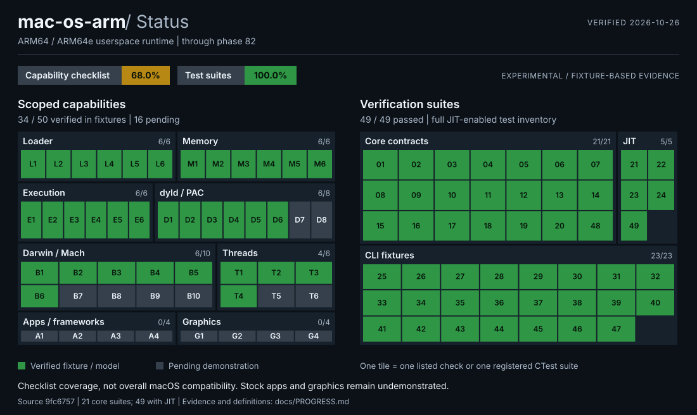

# Progress and evidence

<!-- Generated by tools/render_status.py from docs/status.json. Edit the data, then regenerate. -->



Snapshot: **2026-10-26**, runtime source [`9fc6757`](https://github.com/kallmek3nny/mac-os-arm/commit/9fc67572c602c205fc2b8c196b2d0336aae1e361). Local verification: Windows x86_64, GCC 16.1, Release. The status-only change does not alter runtime source.

**34/50 scoped capability checks (68.0%)** have fixture/model evidence; **16 remain pending**. **49/49 registered CTest suites passed** in the full JIT-enabled build, which includes the 21 core suites. The separate core build also passed 21/21.

## What the percentage means

The denominator is the explicit, curated checklist below. Every check has equal weight. Green means the narrowly worded behavior is implemented and exercised by the linked fixture/model tests. It does not mark a subsystem complete. Gray means the observable demonstration has not been recorded.

**This is not a percentage of macOS, Apple APIs, ARM instructions, engineering effort, or real-app compatibility.** There is no complete inventory for those. Checks differ in difficulty, may share a test suite, and may be revised as the roadmap changes. A suite may contain many assertions; each suite is counted once on the right-hand map. The graphics work in the separate mac-os repository does not count toward this runtime.

This snapshot adds a progress inventory; its pending entries are explicit future acceptance targets, not a claim that a complete macOS compatibility plan exists. See [runtime status and limitations](STATUS.md) for context.

The [source revision's GitHub CI](https://github.com/kallmek3nny/mac-os-arm/actions/runs/40256796551) passed Ubuntu/macOS core jobs and the then-filtered Linux JIT job. The workflow now runs the entire JIT-enabled CTest inventory, including CLI fixtures. The green test map records the dated full local run above; it is not a live GitHub CI badge.

## Capability checklist

### Mach-O loader (6/6)

| ID | Scoped acceptance check | Evidence |
| --- | --- | --- |
| L1 | **Verified**: Parse little-endian ARM64 Mach-O | [Source / fixture](../src/macho.cpp); `macho-parser` |
| L2 | **Verified**: Reject invalid load-command ranges | [Source / fixture](../tests/test_macho_legacy.inc); `macho-parser` |
| L3 | **Verified**: Load bounded segments and zero-fill | [Source / fixture](../src/image_loader.cpp); `image-loader` |
| L4 | **Verified**: Resolve a supported executable entry point | [Source / fixture](../tests/test_parse_load_integration.cpp); `parse-load-integration` |
| L5 | **Verified**: Load supported dependent dylib images | [Source / fixture](../src/dyld_graph.cpp); `dyld-loaded-image-graph` |
| L6 | **Verified**: Bootstrap a parsed image into a guest session | [Source / fixture](../src/session.cpp); `macho-session-bootstrap` |

### Guest memory (6/6)

| ID | Scoped acceptance check | Evidence |
| --- | --- | --- |
| M1 | **Verified**: Enforce guest mapping bounds and permissions | [Source / fixture](../src/address_space.cpp); `guest-address-space` |
| M2 | **Verified**: Unmap subranges and split mappings | [Source / fixture](../tests/test_dynarmic_munmap.inc); `dynarmic-arm64-jit` |
| M3 | **Verified**: Create supported anonymous mmap regions | [Source / fixture](../tests/test_dynarmic_anonymous_mmap.inc); `dynarmic-arm64-jit` |
| M4 | **Verified**: Change subrange protection with mprotect | [Source / fixture](../tests/test_dynarmic_mprotect.inc); `dynarmic-arm64-jit` |
| M5 | **Verified**: Read and write across adjacent mapping fragments | [Source / fixture](../tests/test_dynarmic_cross_mapping_memory.inc); `dynarmic-arm64-jit` |
| M6 | **Verified**: Allocate owned guest stacks with sealed guards | [Source / fixture](../tests/test_dynarmic_owned_stacks.inc); `dynarmic-arm64-jit` |

### ARM64 execution (6/6)

| ID | Scoped acceptance check | Evidence |
| --- | --- | --- |
| E1 | **Verified**: Execute ARM64 instructions with pinned Dynarmic | [Source / fixture](../src/dynarmic_backend.cpp); `dynarmic-arm64-jit` |
| E2 | **Verified**: Connect translated memory accesses to guest memory | [Source / fixture](../tests/test_dynarmic_legacy.inc); `dynarmic-arm64-jit` |
| E3 | **Verified**: Bound process execution with instruction budgets | [Source / fixture](../src/process.cpp); `execution-contract`, `process-runner` |
| E4 | **Verified**: Dispatch guest supervisor calls and resume execution | [Source / fixture](../tests/test_session_dynarmic.cpp); `raw-macho-dynarmic-session` |
| E5 | **Verified**: Invalidate translated code after executable-memory changes | [Source / fixture](../tests/test_dynarmic_code_generation.inc); `dynarmic-arm64-jit` |
| E6 | **Verified**: Run raw Mach-O CLI fixtures with stdout and exit status | [Source / fixture](../src/macho_run.cpp); `macho-run-hello-exit-status`, `macho-run-guest-argc` |

### dyld / ARM64e (6/8)

| ID | Scoped acceptance check | Evidence |
| --- | --- | --- |
| D1 | **Verified**: Resolve supported dyld paths and dependency plans | [Source / fixture](../src/dyld_paths.cpp); `dyld-path-resolution`, `dyld-dependency-planning` |
| D2 | **Verified**: Read export tries and resolve modeled symbols | [Source / fixture](../src/dyld_symbols.cpp); `dyld-exports-trie`, `dyld-symbol-resolution` |
| D3 | **Verified**: Parse and apply supported generic chained fixups | [Source / fixture](../src/dyld_fixup_apply.cpp); `dyld-chained-fixups-metadata`, `dyld-generic-chained-fixup-apply` |
| D4 | **Verified**: Apply supported ARM64e fixups with software PAC policy | [Source / fixture](../src/dyld_fixup_pauth.cpp); `dyld-arm64e-chained-fixup-apply`, `dyld-authenticated-arm64e-fixup-apply`, `pointer-auth-policy` |
| D5 | **Verified**: Execute ordered synthetic image initializers | [Source / fixture](../tests/test_dynarmic_authenticated_initializers.inc); `dynarmic-arm64-jit` |
| D6 | **Verified**: Materialize program variables and commpage bootstrap | [Source / fixture](../tests/test_program_vars_dynarmic.cpp); `raw-macho-dynarmic-session-program-vars`, `raw-macho-dynarmic-session-commpage` |
| D7 | **Pending**: Load and execute a stock dyld shared-cache dependency closure | Pending; no passing demonstration recorded |
| D8 | **Pending**: Bootstrap unmodified stock libSystem successfully | Pending; no passing demonstration recorded |

### Darwin / Mach (6/10)

| ID | Scoped acceptance check | Evidence |
| --- | --- | --- |
| B1 | **Verified**: Support scoped scalar, vectored and positional I/O | [Source / fixture](../src/darwin_syscall.cpp); `darwin-syscall-dispatch`, `macho-run-stdin-echo`, `macho-run-writev-stdout`, `macho-run-readv-stdin`, `macho-run-pread-stdin` |
| B2 | **Verified**: Model descriptor close, duplication and fcntl flags | [Source / fixture](../src/macho_run.cpp); `macho-run-close-stdout`, `macho-run-dup2-stdout`, `macho-run-fcntl-dupfd-stdout`, `macho-run-fcntl-nosigpipe-stdio` |
| B3 | **Verified**: Model selected stat, ioctl, seek and sync operations | [Source / fixture](../tests/macho_run_fixture.cpp); `macho-run-fstat-stdin`, `macho-run-ioctl-stdin`, `macho-run-lseek-stdin`, `macho-run-fsync-stdio` |
| B4 | **Verified**: Provide host-backed entropy and scoped time calls | [Source / fixture](../tests/test_darwin_syscall.cpp); `darwin-syscall-dispatch` |
| B5 | **Verified**: Report synthetic process identity and selected resource limits | [Source / fixture](../src/darwin_syscall.cpp); `darwin-syscall-dispatch`, `macho-run-getrlimit-stack`, `macho-run-getdtablesize` |
| B6 | **Verified**: Handle modeled Mach VM, port and guest IPC operations | [Source / fixture](../src/mach_trap.cpp); `mach-trap-dispatch`, `mach-msg-transport`, `dynarmic-mach-msg-transport` |
| B7 | **Pending**: Open guest filesystem paths with application-level semantics | Pending; no passing demonstration recorded |
| B8 | **Pending**: Support guest sockets and networking | Pending; no passing demonstration recorded |
| B9 | **Pending**: Deliver guest signals with Darwin process semantics | Pending; no passing demonstration recorded |
| B10 | **Pending**: Connect guest Mach IPC to required host services | Pending; no passing demonstration recorded |

### Guest threads (4/6)

| ID | Scoped acceptance check | Evidence |
| --- | --- | --- |
| T1 | **Verified**: Schedule manually constructed cooperative guest contexts | [Source / fixture](../tests/test_dynarmic_cooperative_threads.inc); `dynarmic-arm64-jit` |
| T2 | **Verified**: Keep worker pthread TSD and errno state isolated | [Source / fixture](../tests/test_dynarmic_owned_errno_tsd.inc); `dynarmic-arm64-jit` |
| T3 | **Verified**: Bootstrap modeled main-thread pthread layout and errno | [Source / fixture](../tests/test_dynarmic_main_thread_errno_tsd.inc); `dynarmic-arm64-jit` |
| T4 | **Verified**: Retire a resource-free guest context without killing siblings | [Source / fixture](../tests/test_dynarmic_thread_termination.inc); `dynarmic-arm64-jit` |
| T5 | **Pending**: Successfully register libpthread and create threads through bsdthread | Pending; no passing demonstration recorded |
| T6 | **Pending**: Run real pthread synchronization, waits and cancellation | Pending; no passing demonstration recorded |

### Apps / frameworks (0/4)

| ID | Scoped acceptance check | Evidence |
| --- | --- | --- |
| A1 | **Pending**: Run an independently compiled, unmodified ARM64 CLI program | Pending; no passing demonstration recorded |
| A2 | **Pending**: Execute stock Objective-C runtime and message dispatch | Pending; no passing demonstration recorded |
| A3 | **Pending**: Run an unmodified Foundation program | Pending; no passing demonstration recorded |
| A4 | **Pending**: Launch an unmodified AppKit application | Pending; no passing demonstration recorded |

### Graphics / desktop (0/4)

| ID | Scoped acceptance check | Evidence |
| --- | --- | --- |
| G1 | **Pending**: Implement a guest graphics API translation path | Pending; no passing demonstration recorded |
| G2 | **Pending**: Connect the architecture-neutral GPU handoff | Pending; no passing demonstration recorded |
| G3 | **Pending**: Present guest windows through the required display services | Pending; no passing demonstration recorded |
| G4 | **Pending**: Demonstrate an unmodified graphical application end to end | Pending; no passing demonstration recorded |

## Passing test inventory

IDs match the numbered tiles in the verification map.

| Tile | Registered CTest suite | Group | Result |
| --- | --- | --- | --- |
| 01 | `macho-parser` | Core contracts | Pass |
| 02 | `guest-address-space` | Core contracts | Pass |
| 03 | `image-loader` | Core contracts | Pass |
| 04 | `dyld-path-resolution` | Core contracts | Pass |
| 05 | `dyld-dependency-planning` | Core contracts | Pass |
| 06 | `dyld-exports-trie` | Core contracts | Pass |
| 07 | `dyld-loaded-image-graph` | Core contracts | Pass |
| 08 | `dyld-symbol-resolution` | Core contracts | Pass |
| 09 | `dyld-chained-fixups-metadata` | Core contracts | Pass |
| 10 | `dyld-generic-chained-fixup-apply` | Core contracts | Pass |
| 11 | `dyld-arm64e-chained-fixup-apply` | Core contracts | Pass |
| 12 | `dyld-authenticated-arm64e-fixup-apply` | Core contracts | Pass |
| 13 | `pointer-auth-policy` | Core contracts | Pass |
| 14 | `parse-load-integration` | Core contracts | Pass |
| 15 | `execution-contract` | Core contracts | Pass |
| 16 | `darwin-syscall-dispatch` | Core contracts | Pass |
| 17 | `mach-trap-dispatch` | Core contracts | Pass |
| 18 | `mach-msg-transport` | Core contracts | Pass |
| 19 | `process-runner` | Core contracts | Pass |
| 20 | `macho-session-bootstrap` | Core contracts | Pass |
| 21 | `dynarmic-arm64-jit` | Translated execution | Pass |
| 22 | `raw-macho-dynarmic-session` | Translated execution | Pass |
| 23 | `raw-macho-dynarmic-session-program-vars` | Translated execution | Pass |
| 24 | `dynarmic-mach-msg-transport` | Translated execution | Pass |
| 25 | `macho-run-hello-exit-status` | CLI fixtures | Pass |
| 26 | `macho-run-guest-argc` | CLI fixtures | Pass |
| 27 | `macho-run-stdin-echo` | CLI fixtures | Pass |
| 28 | `macho-run-stdin-eof` | CLI fixtures | Pass |
| 29 | `macho-run-close-stdout` | CLI fixtures | Pass |
| 30 | `macho-run-fstat-stdin` | CLI fixtures | Pass |
| 31 | `macho-run-ioctl-stdin` | CLI fixtures | Pass |
| 32 | `macho-run-writev-stdout` | CLI fixtures | Pass |
| 33 | `macho-run-readv-stdin` | CLI fixtures | Pass |
| 34 | `macho-run-lseek-stdin` | CLI fixtures | Pass |
| 35 | `macho-run-pread-stdin` | CLI fixtures | Pass |
| 36 | `macho-run-fcntl-stdio` | CLI fixtures | Pass |
| 37 | `macho-run-fcntl-setfl-stdio` | CLI fixtures | Pass |
| 38 | `macho-run-getrlimit-stack` | CLI fixtures | Pass |
| 39 | `macho-run-setrlimit-stack` | CLI fixtures | Pass |
| 40 | `macho-run-getdtablesize` | CLI fixtures | Pass |
| 41 | `macho-run-dup-stdout` | CLI fixtures | Pass |
| 42 | `macho-run-dup2-stdout` | CLI fixtures | Pass |
| 43 | `macho-run-fcntl-dupfd-stdout` | CLI fixtures | Pass |
| 44 | `macho-run-ioctl-fioclex-stdio` | CLI fixtures | Pass |
| 45 | `macho-run-ioctl-fionbio-stdio` | CLI fixtures | Pass |
| 46 | `macho-run-fcntl-nosigpipe-stdio` | CLI fixtures | Pass |
| 47 | `macho-run-fsync-stdio` | CLI fixtures | Pass |
| 48 | `darwin-commpage-bootstrap` | Core contracts | Pass |
| 49 | `raw-macho-dynarmic-session-commpage` | Translated execution | Pass |

## Updating the snapshot

Edit the explicit capability checks in [status.json](status.json), preserving their IDs. Add source and passing test evidence before marking a check verified. Do not infer broad support from a syscall name or from a passing synthetic fixture.

After building both configurations, record complete fresh runs:

```sh
ctest --test-dir build -C Release --output-on-failure --timeout 30 --output-junit core-results.xml
ctest --test-dir build-jit -C Release --output-on-failure --timeout 30 --output-junit jit-results.xml
python tools/render_status.py --record-junit build-jit/jit-results.xml --core-junit build/core-results.xml --ctest-build build-jit --date YYYY-MM-DD --source-ref SOURCE_SHA
python tools/render_status.py --check --ctest-build build-jit
```

`SOURCE_SHA` is the tested runtime commit. Recording rejects failed, skipped, missing, or mismatched suites. The generator requires Python 3.10 or newer, uses only its standard library, and deterministically produces [the SVG](assets/status.svg) and this report. CI checks generated files and the registered test inventory. Source links document the manual capability assessment; passing a suite alone cannot certify a new capability.
